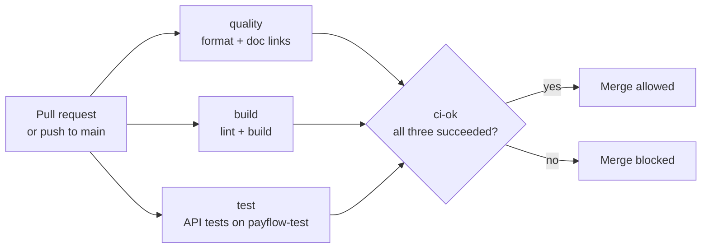
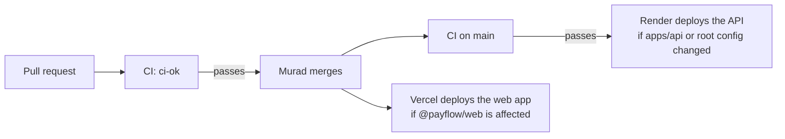

# CI in PayFlow

What runs on every pull request and push to `main`, and how it decides whether a change may be merged. The workflow is [`.github/workflows/ci.yml`](../.github/workflows/ci.yml) (CI added in [spec 001](specs/001-nx-migration.md), tests in [003/T9](specs/003-api-contract-tests.md#tasks), split into jobs after spec 003).

## The jobs

| Job | Runs | Notes |
|---|---|---|
| `quality` | `npm run format:check` (Prettier), `npm run docs:links` (every link and heading link in `docs/`) | whole repo, every time |
| `build` | `npx nx affected -t lint build` | only the apps a change touches |
| `test` | `npx nx affected -t test` | only the apps a change touches; the **only** job that gets the `MONGO_URI_TEST` secret |
| `ci-ok` | waits for the three, fails unless all of them succeeded | the **only required check** in the ruleset |

The three jobs run **in parallel**, each on its own fresh machine, so each one checks out the code and runs `npm ci` itself. The npm cache keeps that fast. The whole run takes about as long as the slowest job.

## Why the `ci-ok` gate

- **One required check.** The ruleset `protect-main` requires only `ci-ok`. Jobs can be added, renamed or removed in `ci.yml` without touching the ruleset.
- **`if: always()`.** Without it, GitHub *skips* `ci-ok` when a job before it fails, and a skipped required check can count as passing. With it, `ci-ok` always runs, prints the results (e.g. `quality, build, test: failure success success`) and fails unless all three are `success`.
- **Proven** on a throwaway PR ([#31](https://github.com/muradhaji/payflow/pull/31)): a formatting break failed `quality` and `ci-ok`, while `build` and `test` passed.

## What "affected" means

`nx affected` compares a pull request with `main` (and a push to `main` with the last green commit there) and runs targets only for the apps whose files changed (or whose dependencies, like the lockfile, changed).

| A change to… | `build` checks | `test` runs |
|---|---|---|
| `apps/api/**` | the API | the API tests |
| `apps/web/**` | the web app | nothing (the web app has no tests yet) |
| `docs/**`, `.github/**` | nothing | nothing |
| root `package-lock.json` | apps whose dependencies changed | their tests |

`quality` always runs, so docs-only PRs are still checked for formatting and broken links.

The API has no lint setup yet, so `lint` checks only the web app (see [Known issues](architecture.md#known-issues)).

## From pull request to production

- **Render** waits for the checks on `main` (`autoDeployTrigger: checksPass` in [`render.yaml`](../render.yaml)), so a failing test also stops an API deploy.
- **Vercel** builds on its own, independent of CI; its "Ignored Build Step" skips commits that don't affect the web app.

## Secrets

- `MONGO_URI_TEST`: repository secret (Settings → Secrets and variables → Actions). The connection string of the Atlas user `payflow-ci`, which can read and write `payflow-test` only. Only the `test` job receives it.
- Pull requests from forks get no secrets, so their API tests would fail. Only Murad opens pull requests.

## Common changes

| Task | What to do |
|---|---|
| Run the checks locally | `npm run format:check`, `npm run docs:links`, `npx nx affected -t lint build test` (tests need `MONGO_URI_TEST` in `apps/api/.env`) |
| Add a job | Add it to `ci.yml` **and** to `needs:` of `ci-ok`, or it is not part of the gate. Update this file. |
| Add tests to the web app | Add a `test` script to `apps/web/package.json`; the `test` job picks it up through `nx affected`. |
| `test` fails with "bad auth" or a timeout | Atlas refused the connection or the secret is wrong: check Network Access and the `MONGO_URI_TEST` secret, then re-run the job. |
| Change the required check | Settings → Rules → Rulesets → `protect-main`. The new check must have run once before it can be selected. |
