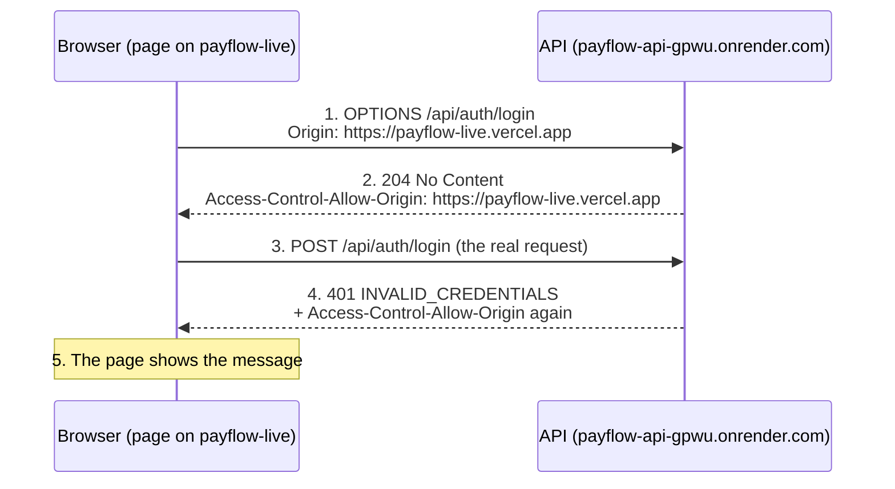
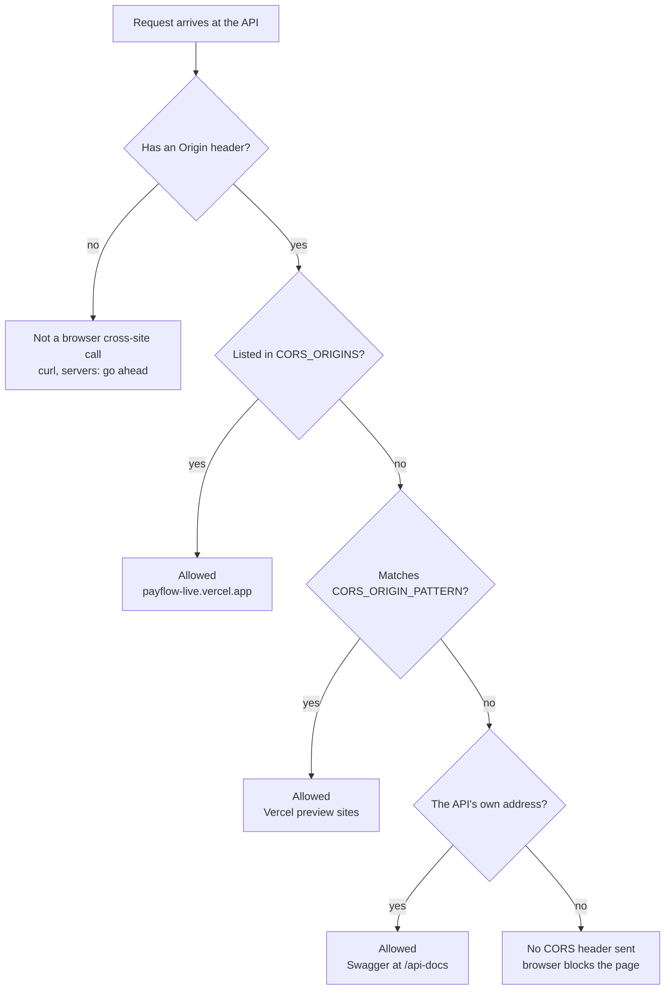

# CORS in PayFlow

How the API decides which websites may call it from a browser. The code is in [`apps/api/src/config/cors.ts`](../apps/api/src/config/cors.ts) (added in [002/T7](specs/002-backend-hardening.md#tasks)).

## What CORS is

An **origin** is scheme + host + port, e.g. `https://payflow-live.vercel.app`. Browsers enforce a rule: **JavaScript on one origin may not read responses from another origin** unless that server allows it with a response header:

```
Access-Control-Allow-Origin: https://payflow-live.vercel.app
```

The PayFlow web app and API are on different origins (`payflow-live.vercel.app` and `payflow-api-gpwu.onrender.com`), so every API call from the web app depends on that header.

For requests that send JSON or an `Authorization` header (all PayFlow API calls), the browser first sends a **preflight**: an `OPTIONS` request that asks for permission.

### A login from the live site



If the site is **not** allowed, step 2 comes back **without** `Access-Control-Allow-Origin`. The browser stops there: the real request is never sent, and the page only sees "Failed to fetch".

## How the API decides



## Settings

| Variable | Production value | Meaning |
|---|---|---|
| `CORS_ORIGINS` | `https://payflow-live.vercel.app` | Exact origins, comma-separated |
| `CORS_ORIGIN_PATTERN` | `^https://payflow(-[a-z0-9]+)+-murads-projects-644222af\.vercel\.app$` | Regex for preview deployments (optional) |

- Both values are in [`render.yaml`](../render.yaml) and set on the Render service. They are not secret.
- Locally, without `CORS_ORIGINS`, only `http://localhost:5173` (the Vite dev server) is allowed. A missing setting makes the API stricter, never more open.

**The preview pattern, piece by piece:**

| Part | Meaning |
|---|---|
| `^` … `$` | The **whole** origin must match, not just a part of it |
| `https://payflow` | Must start like this |
| `(-[a-z0-9]+)+` | One or more dash-separated parts, e.g. `-9rwxh4f62` or `-frontend-802ctnamv` |
| `-murads-projects-644222af` | The Vercel team's unique suffix; no one else can create URLs ending in it |
| `\.vercel\.app` | `\.` is a literal dot, not "any character" |

## The code, step by step

**Default list.** `DEFAULT_ORIGINS = ['http://localhost:5173']` is used when `CORS_ORIGINS` is empty.

**Reading the settings (`getConfig`).** The settings are read on the **first request**, not when the file loads. In `index.ts` all imports run before `dotenv.config()` loads `.env`, so reading earlier would miss the local values. The text from `CORS_ORIGINS` is split on commas, trimmed, and empty entries are dropped. The pattern is turned into a regular expression once.

**The three checks (`isAllowed`).**

1. `origins.includes(origin)`: an **exact** match. `https://payflow-live.vercel.app.evil.com` does not match.
2. `pattern?.test(origin) ?? false`: does it match the preview pattern? Skipped (and counted as "no") when no pattern is set.
3. `` origin === `${req.protocol}://${req.get('host')}` ``: is the caller the API itself? Swagger at `/api-docs` is served by the API and calls it, and browsers send an `Origin` even then. `req.protocol` is `https` on Render only because of `app.set('trust proxy', 1)`: Render's proxy talks plain `http` to the server and passes the original scheme in a header.

**The decision (`corsOptions`).** The `cors` package calls this for every request:

- `req.header('Origin')`: browsers set this header themselves; page scripts cannot fake it.
- No `Origin` → not a browser cross-site call (curl, servers, opening a URL directly), so CORS does not apply.
- `{ origin: true }` → the package copies the request's origin into `Access-Control-Allow-Origin` (allowed).
- `{ origin: false }` → no CORS headers at all (the browser blocks the page).

**Order in `index.ts`:**

```ts
app.use(helmet());            // security headers on every response
app.use(cors(corsOptions));   // CORS decision on every request, before any route
app.use(express.json());
```

The `cors` package answers `OPTIONS` preflights itself with `204`, so they never reach the routes or the rate limiter.

## What CORS protects, and what it doesn't

- **It protects users:** another website cannot use a visitor's browser to call the PayFlow API and read the answers.
- **It does not stop non-browser clients.** curl, scripts and servers ignore CORS. The protection against those is authentication (JWT), input checks and the login rate limit (see [`architecture.md`](architecture.md#api-safety-spec-002)).
- **For PayFlow the benefit is moderate:** logins are stored in `localStorage` and sent as an `Authorization` header, not as cookies, so a foreign site could not use a visitor's login anyway. CORS mainly keeps unknown websites out, as an extra layer.

## Common changes

| Task | What to do |
|---|---|
| Add another allowed site | Add it to `CORS_ORIGINS` on Render (comma-separated) and in `render.yaml` |
| Rename the Vercel project or team | Update `CORS_ORIGIN_PATTERN` on Render and in `render.yaml`, or previews lose API access |
| Test locally with another port | Set `CORS_ORIGINS` in `apps/api/.env` |
| Check a site from the command line | `curl -s -D - -o /dev/null -X OPTIONS <API>/api/auth/login -H "Origin: <site>" -H "Access-Control-Request-Method: POST"`, then look for `Access-Control-Allow-Origin` |
